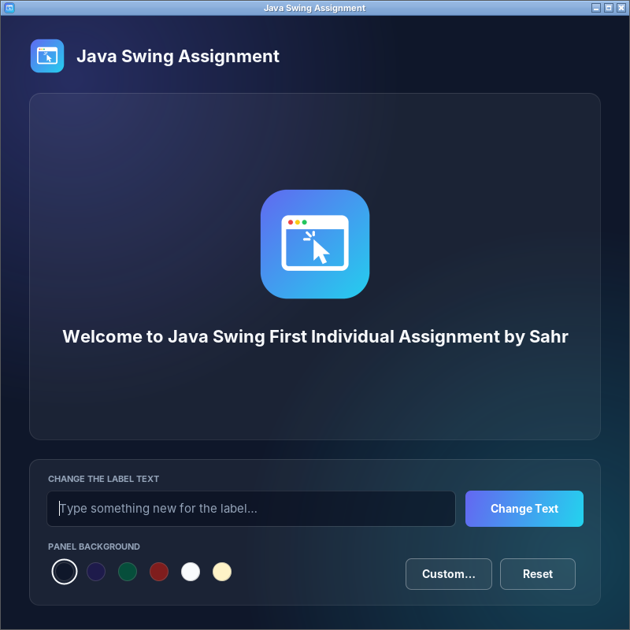

# PROG209 – Basic Interactive GUI (Java Swing)

Individual assignment for **PROG209 Event Driven Programming**, Limkokwing University of Creative Technology, Sierra Leone.
**Student:** Sahr Kemoh Ngaujah · **Examiner:** Amandus Benjamin Coker



## Features
- 800 × 800 `JFrame` titled **"Java Swing Assignment"** with a custom logo (`ImageIcon`), closes on the X button.
- `JPanel panel` holding `JLabel label` with the text *"Welcome to Java Swing First Individual Assignment by Sahr"* and the logo.
- **Change Text** – type in the box and click the button (or press Enter) to change the label.
- **Colour circles** – one click changes the panel background (Midnight, Deep Indigo, Forest, Wine, Cloud, Sand).
- **Custom…** – opens a full colour picker for any background colour.
- **Reset** – restores the original text and background.
- Text colours switch automatically on light backgrounds so everything stays readable.

## Classes (inheritance)
| Class | Extends | Purpose |
|---|---|---|
| `BaseWindow` | – (parent) | Creates and configures the `JFrame` in its constructor |
| `SwingAssignment` | `BaseWindow` | Main class: builds the panel, label and controls; `super("Java Swing Assignment", 800, 800)` |
| `RoundedPanel` | `JPanel` | Rounded card background |
| `RoundedButton` | `JButton` | Gradient / outline buttons with hover effect |
| `ColourSwatch` | `JButton` | Round colour-picker button |

## Project structure
```
src/           Java source files + logo.png
screenshots/   Screenshots of the running app
wireframe/     Figma wireframe export
PROG209_Sahr_Swing_Assignment.docx   Documentation
```

## Wireframe
Designed in Figma: https://www.figma.com/design/35cVrKGiYNXCoDbFic19er

## How to run
**IntelliJ IDEA:** File → Open → select this folder. Right-click `src` → Mark Directory as → Sources Root. Open `SwingAssignment.java` and click ▶ next to `main`.

**Terminal:**
```
javac -d out src/*.java
cp src/logo.png out/
java -cp out SwingAssignment
```
Requires JDK 17 or newer.
